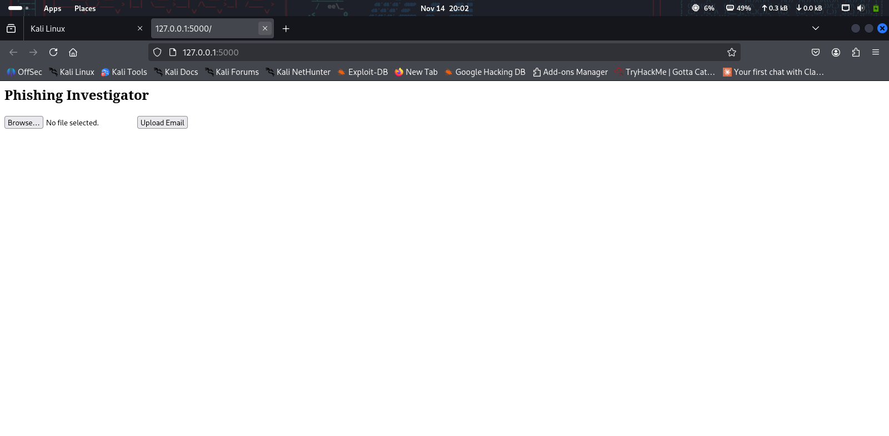
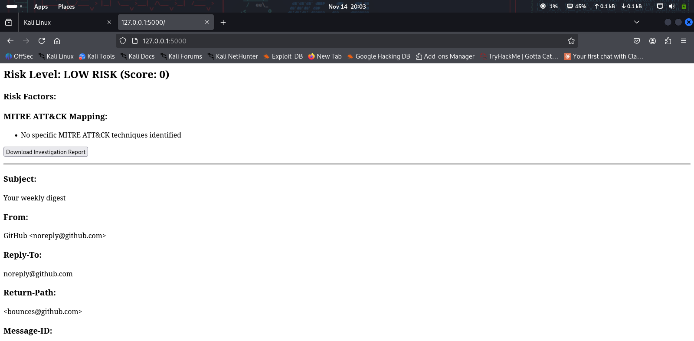
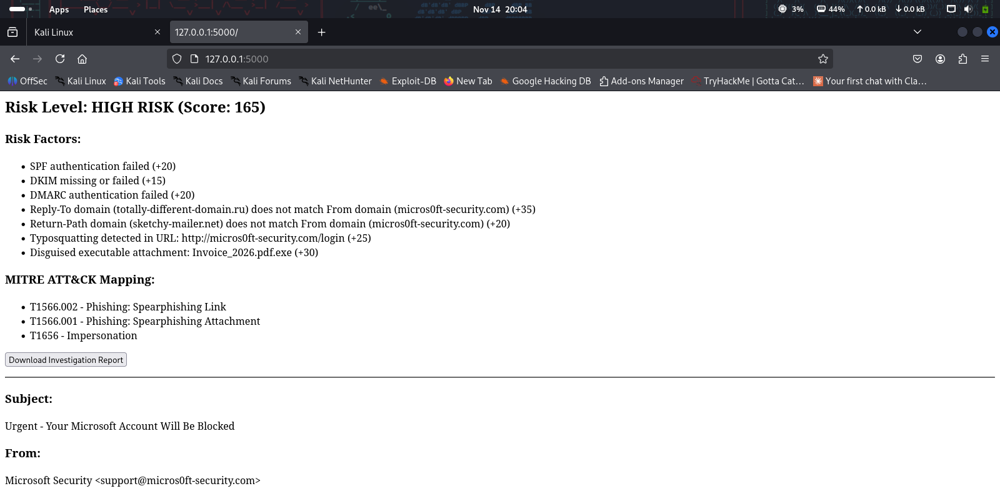
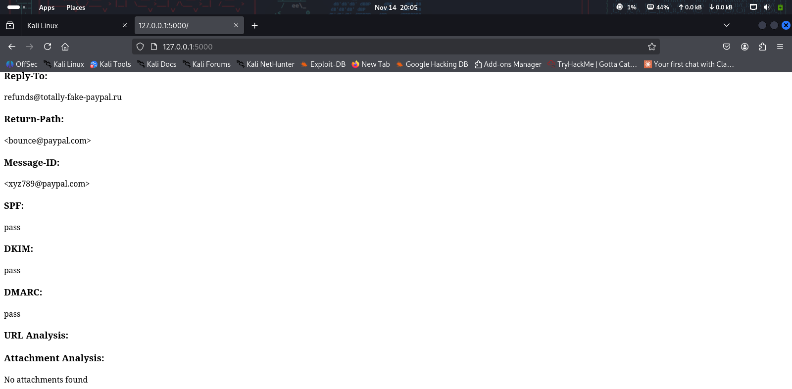
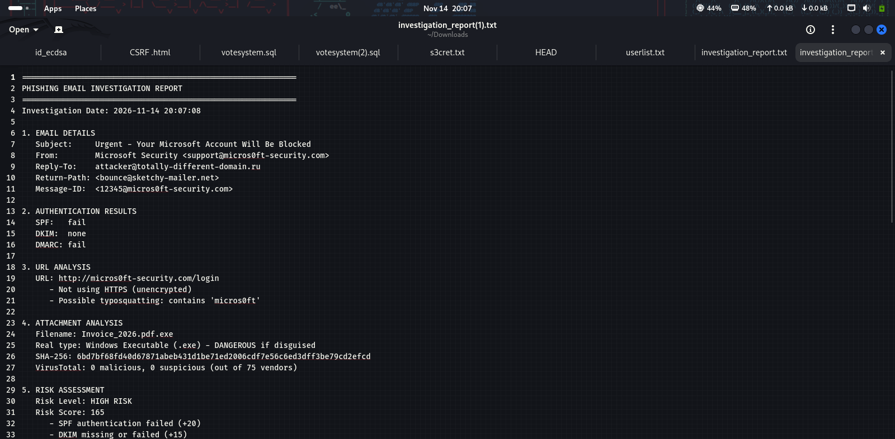
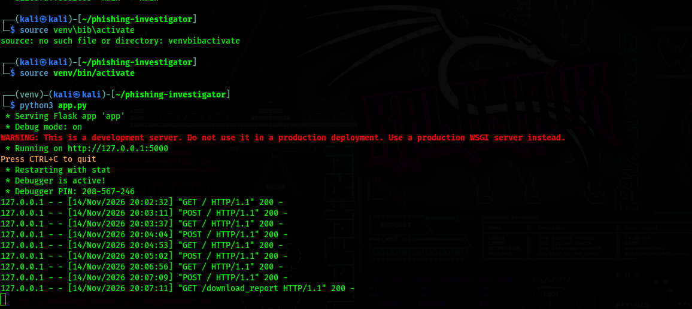

# Phishing Email Analysis & Investigation System

A tool I built to check if an email is a phishing attempt. You upload an email file, and it looks at the sender, the links, any attachments, and tells you how risky the email is — and why.

---

## What this does

Imagine someone gets a scary email like *"Your account will be blocked, click here!"* Instead of guessing if it's real or fake, you upload it into this tool, and it checks it for you:

- Who really sent it (not just who it claims to be from)
- Whether the email passed basic security checks
- Whether any links look fake or suspicious
- Whether any attached files are secretly dangerous
- What other security tools around the world think about those links/files
- A final score: is this Low Risk, Medium Risk, or High Risk — and exactly why

At the end, you can download a full report, like something a real security analyst would write up.

## Why I built this

I'm studying to become a SOC analyst. Phishing emails are one of the most common ways attackers try to trick people, so I wanted to build something that does the checking automatically — and I wanted to build every part myself, step by step, instead of copying a finished project. That way I actually understand how each piece works.

## The 8 things it checks (in plain words)

1. **Upload** — you pick an email file and the app opens it up
2. **Who really sent it** — compares the "From" name to where replies actually go; attackers sometimes fake the name but can't hide where replies land
3. **Security stamps (SPF/DKIM/DMARC)** — checks if the email has 3 types of "verified sender" stamps, or if they're missing/failed
4. **Links** — checks if any link looks like a trick, like `micros0ft.com` with a zero instead of the letter "o"
5. **Attachments** — checks if a file is secretly something dangerous pretending to be a normal file (like a program disguised as a PDF)
6. **VirusTotal check** — asks a free online service, "has anyone else seen this link or file before, and was it bad?"
7. **Risk Score** — adds up everything suspicious into one number, then labels it Low, Medium, or High Risk
8. **Report** — writes up everything it found into a downloadable file

## Built with

Python, Flask (to make it a website), and a few small Python tools: one for reading emails, one for calculating file fingerprints (SHA-256), and one for talking to VirusTotal.

## Screenshots

**The upload form**


**A clean email — correctly scored Low Risk**


**A full phishing email — High Risk, with every module's findings and MITRE ATT&CK mapping**


**A spoofed sender that passed authentication but still got caught — Medium Risk**


**The downloaded investigation report**


**The app running in the terminal**


## How I tested it

I didn't just test it with one obviously-bad email. I tried 3 different kinds, to make sure it could tell them apart:

| Test email | What I expected | What it gave |
|---|---|---|
| A real, clean GitHub email | Should be marked safe | **Low Risk** |
| A fake, obvious phishing email (bad links, bad attachment) | Should be marked dangerous | **High Risk** |
| A sneaky fake PayPal email (passed the security stamps, but replies go somewhere weird) | Should still catch it | **Medium Risk** |

That third one is the one I'm proudest of. At first, my tool missed it completely — because it only checked the security stamps, not where replies actually go. I found that gap myself, fixed it, and now it catches that trick too.

## What it can't do yet

- It only knows a small list of "fake brand name" tricks, not every possible trick
- It only recognizes a couple of file types (like fake PDFs pretending to be programs)
- A "nothing found" result from VirusTotal doesn't always mean something is 100% safe — it might just be something nobody's seen before
- It checks one email at a time, not a whole inbox

## What I'd like to add later

- A smarter way to catch fake brand names
- Saving past scans so I don't lose the history
- A proper PDF version of the report, not just plain text
- Matching more types of attacks to official attack categories (MITRE ATT&CK)

## What I learned

The biggest lesson: passing the "official" security checks doesn't always mean an email is safe. My spoofed PayPal test proved that — it passed every official check, but was still a trick, because the reply address was fake. I also made a real mistake early on (forgot to clean up text before showing it on the webpage, which can let attackers run harmful code) and fixing that taught me more than reading about it ever would have.

---

## How to run it yourself

```bash
git clone https://github.com/vishakhsec/phishing-investigator.git
cd phishing-investigator
python3 -m venv venv
source venv/bin/activate
pip install -r requirements.txt
```

Add your own VirusTotal key in a file called `.env`:
VT_API_KEY=your_api_key_here

Then run it:
```bash
python3 app.py
```

Open `http://127.0.0.1:5000` in your browser and upload a `.eml` file.

## One honest note

All the test emails in this project are ones I made up myself — no real phishing, no real malware, nothing private. The "dangerous" attachment is just a few fake bytes, not an actual working program.

